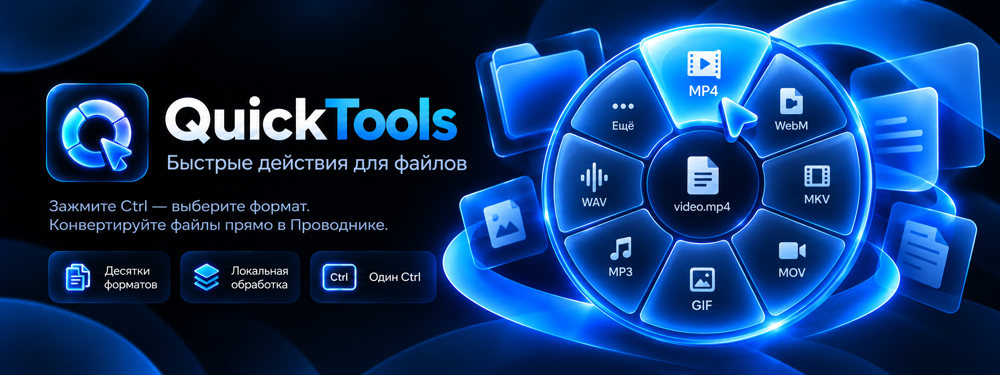
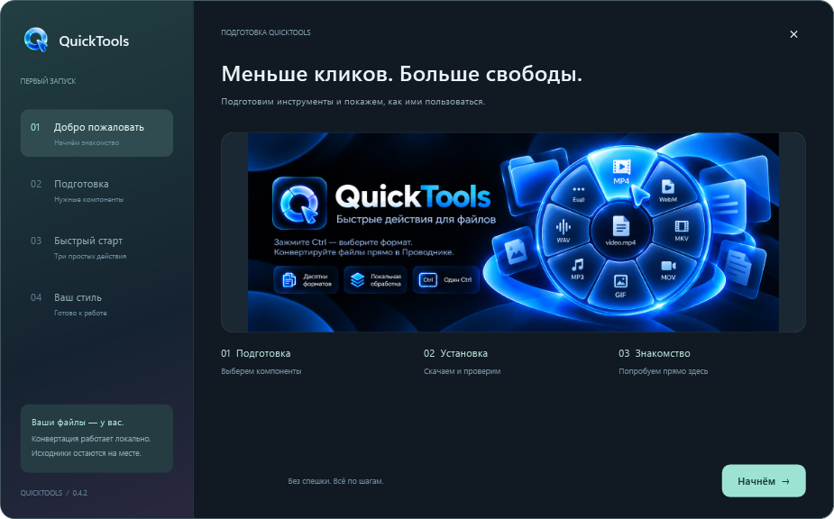
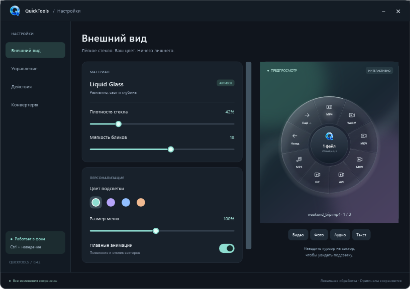
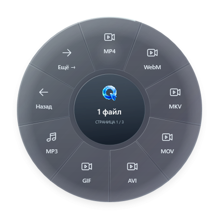

<p align="center"></p>
<h1 align="center">QuickTools</h1>
<p align="center"><b>Один Ctrl. Нужный формат. Готово.</b></p>
<p align="center">Радиальное меню быстрых действий для файлов в Проводнике Windows.</p>
<p align="center"><a href="https://github.com/QuickProducts/QuickTools/releases/tag/v0.4.2"><b>Скачать для Windows</b></a> · <a href="https://github.com/QuickProducts/QuickTools/wiki">Wiki</a> · <a href="docs/wiki/Formats.md">Форматы</a> · <a href="https://github.com/QuickProducts/QuickTools/issues">Сообщить об ошибке</a></p>
<p align="center"><code>Windows 10 / 11</code> &nbsp; <code>x64</code> &nbsp; <code>C# · WPF · .NET 8</code> &nbsp; <code>0.4.2 · preview</code></p>

---

## Файлы — без лишних переходов

Удерживайте **Ctrl** над файлом в Проводнике или на рабочем столе. QuickTools покажет круговое меню с подходящими действиями. Для группы выделенных файлов используйте **Ctrl + Space**.

Выберите сектор — конвертация выполнится локально, а результат появится рядом с исходником. Если папка недоступна для записи, QuickTools сохранит результат в свою папку и покажет точный путь.

| Быстрые действия | Интерфейс | Работа с результатами |
|:---|:---|:---|
| Видео, аудио, изображения и документы | Стеклянный круг, иконки и подсветка | Исходники не перезаписываются |
| MP4 → WebM, видео → MP3, PNG → ICO | Цвет, размер и задержка открытия | Проверка медиа через ffprobe |
| ZIP, TAR, GZIP, SHA-256 и пути | Страницы форматов через «Ещё» | История задач с путями и ошибками |
| Текстовые копии с другим расширением | Пошаговое знакомство | Фоновая обработка и ограничение потоков |

## Установка

1. Скачайте **[QuickToolsSetup.exe](https://github.com/QuickProducts/QuickTools/releases/download/v0.4.2/QuickToolsSetup.exe)** из [релиза 0.4.2](https://github.com/QuickProducts/QuickTools/releases/tag/v0.4.2).
2. Завершите старый QuickTools через **трей → Выход**, если он запущен.
3. Запустите сетап, выберите папку, компоненты и ярлыки.
4. Пройдите первый запуск: подготовка инструментов, учебное меню и выбор оформления.

**.NET включён в установщик.** Отдельные SDK, WinGet и LibreOffice для использования приложения не нужны. Недостающие конвертеры скачиваются напрямую из релизов проектов с проверкой SHA-256. Для получения компонентов нужен интернет; преобразования выполняются локально.

> Ранняя сборка, EXE пока не подписан. Работа с вкладками Проводника, виртуальными папками и несколькими мониторами зависит от окружения. Границы проверки и диагностика описаны в [документации](docs/wiki/Troubleshooting.md).

## В работе

| Первый запуск | Настройки |
|:---:|:---:|
|  |  |

<p align="center"></p>

*Выше — рендеры интерфейса приложения. Баннер в начале README — иллюстрация продукта.*

## Управление

| Действие | Управление |
|---|---|
| Меню над локальным файлом | Удерживать **Ctrl** и навести курсор |
| Действия для выделенной группы | **Ctrl + Space** в Проводнике |
| Выбрать формат | Клик по сектору, удерживая Ctrl |
| Другие форматы | **«Ещё»** и **«Назад»** |
| Закрыть меню | Отпустить Ctrl, нажать Esc или увести курсор наружу |
| Настройки и история | Меню значка в трее |
| Повторить учебные примеры | **Трей → Знакомство с QuickTools** |

## Форматы

| Тип | Примеры выходных форматов |
|---|---|
| Видео | MP4, WebM, MKV, MOV, AVI, GIF, MPEG, TS; аудио MP3/WAV/FLAC/AAC; кадр PNG |
| Аудио | MP3, WAV, M4A, FLAC, Opus, OGG, AIFF, WMA, AAC, AC3 |
| Изображения | PNG, JPG, WebP, ICO, PDF, AVIF, BMP, TIFF, GIF, TGA, PPM |
| Документы и книги | DOCX, ODT, RTF, TXT, Markdown, HTML, EPUB, LaTeX, Org, RST, PPTX; PDF через Typst |
| PDF | Текст UTF-8; первая страница в PNG или JPG |
| Любые файлы | ZIP, TAR, GZIP, SHA-256, копирование путей |

**TXT → BAT/CMD/PS1/PY/JS создаёт копию текста с новым расширением.** Содержимое не переводится между языками, созданные скрипты не запускаются. Это действие отличается от конвертации документов через Pandoc.

Подробные ограничения и движки — в [таблице форматов](docs/wiki/Formats.md).

## Где результат

Обычно: `имя_converted.ext` рядом с оригиналом. При совпадении имени добавляется номер: `имя_converted_1.ext`.

Если запись рядом с исходником недоступна, используется `%LOCALAPPDATA%\QuickTools\Converted`. **Трей → Задачи и результаты** покажет точный путь. Финальный файл появляется после завершения обработки; пустые заглушки не создаются.

## Локальная обработка

- Конвертации выполняются на компьютере через FFmpeg, ImageMagick, Pandoc, Typst и Poppler.
- Загрузчик не отправляет исходники на сервер конвертации; сеть используется для получения компонентов.
- Настройки, история и журналы хранятся в `%LOCALAPPDATA%\QuickTools`.
- Журналы могут содержать имена и пути файлов. Удаляйте личные данные перед отправкой отчёта в Issues.

## Для разработчиков

Нужны **Windows x64 и .NET 8 SDK**.

```powershell
git clone https://github.com/QuickProducts/QuickTools.git
cd QuickTools
.\build.ps1
.\build.ps1 -Publish
.\build-setup.ps1
```

`dist` — автономное приложение, `release/QuickToolsSetup.exe` — единый установщик.

| Раздел | Документация |
|---|---|
| Процессы и сохранение | [Architecture](docs/wiki/Architecture.md) |
| Сборка и проверки | [Development](docs/wiki/Development.md) |
| Ошибки | [Troubleshooting](docs/wiki/Troubleshooting.md) |
| Изменения | [CHANGELOG](CHANGELOG.md) |
| Сторонние компоненты | [THIRD_PARTY](THIRD_PARTY.md) |

В локальной проверке 0.4.2 прошли **17 медиа-преобразований, 11 преобразований изображений и 2 отрицательных сценария**. Медиа проверялись по кодекам, потокам и полному декодированию. Это не подтверждает работу на любом входе; границы валидации — в [Validation](docs/validation/README.md).

---

<p align="center"><b>QuickTools</b> — часть <a href="https://github.com/QuickProducts">QuickProducts</a>.</p>
