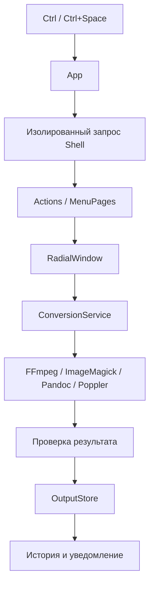

# Архитектура

QuickTools написан на C# / WPF для .NET 8. UI и конвертация разделены, внешние процессы выполняются без блокировки интерфейса.

| Файл | Ответственность |
|---|---|
| `App.cs`, `Native.cs` | Жизненный цикл, трей, проверка клавиш и контекста |
| `ShellQueryService.cs`, `ShellResolver.cs` | Получение путей из оболочки и ограничение времени запроса |
| `Actions.cs`, `MenuPages.cs` | Контекстные действия и страницы |
| `RadialWindow.cs`, `GlassSurface.cs`, `VectorIcon.cs` | Секторы, стеклянное оформление, иконки |
| `ConversionService.cs`, `MediaConverter.cs` | Маршрутизация и медиа-параметры |
| `ProcessRunner.cs` | Фоновые процессы и диагностика |
| `OutputStore.cs` | Временный файл, безопасная фиксация, резервная папка |
| `DependencyManager.cs`, `ToolLocator.cs` | Загрузка, SHA-256, поиск движков |
| `ConversionHistory.cs`, `RuntimeLog.cs` | Результаты и ошибки |
| `FirstRunFlow.cs`, `WelcomeWindow.xaml` | Первичная установка компонентов и знакомство |
| `Setup/` | Собственный WPF-установщик |

Медиа сначала обрабатывается в рабочей папке. Итог проверяется и копируется через промежуточный `.partial`, затем фиксируется без перезаписи существующих результатов. FFmpeg ограничен двумя потоками и сниженным приоритетом. Это уменьшает нагрузку, но не делает перекодирование мгновенным.
